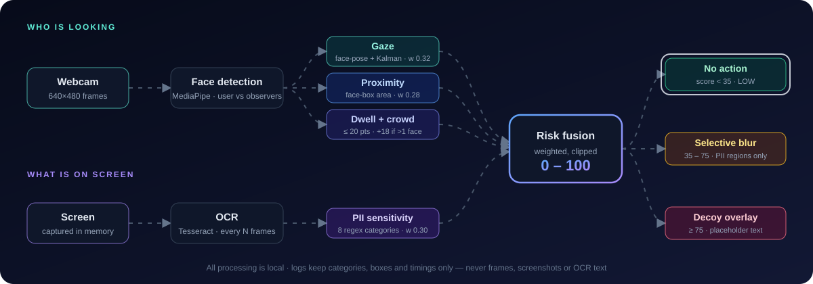

<p align="center">
  
</p>

<p align="center">
  
  
  
  
  
  
</p>

<p align="center">
  <b>OcuVeil</b> watches <i>who</i> is looking at your screen and <i>what</i> is on it, then hides only the sensitive parts, only when someone is actually looking.
</p>

---

## ✨ Why OcuVeil?

Privacy screens and "blur everything" tools treat every glance the same. OcuVeil is **context-aware**. It combines four signals into a single risk score:

| Signal | Question it answers | How |
|---|---|---|
| 👁️ **Gaze** | Is an onlooker facing the screen? | MediaPipe FaceMesh head-pose alignment, Kalman-smoothed |
| 📏 **Proximity** | How close are they? | Relative face-box area of non-primary faces |
| ⏱️ **Dwell** | How long have they been there? | Time with more than one face in view (saturates at 5 s) |
| 🔎 **Content** | Is anything on screen worth stealing? | On-device Tesseract OCR + 8 regex PII categories |

The score drives a **graduated response**. Nothing happens when risk is low. Only the PII regions are blurred when it is medium. A full decoy overlay appears when it is high.

<p align="center">
  
</p>

## 🧮 Risk model

```
risk = clip₀¹⁰⁰( 0.32·gaze + 0.28·proximity + 0.30·pii  +  crowd(+18 if >1 face)  +  dwell(0–20) )
```

| Score | Risk level | Overlay |
|---|---|---|
| `0 – 34` | 🟢 LOW | None |
| `35 – 69` | 🟡 MEDIUM | **Selective blur** of detected PII regions |
| `70 – 74` | 🔴 HIGH | **Selective blur** of detected PII regions |
| `75 – 100` | 🔴 HIGH | **Decoy overlay**: sensitive values are replaced with placeholders |

All weights, thresholds and feature switches live in [`configs/risk.json`](configs/risk.json). They are heuristic defaults, not learned values.

**PII categories:** payment card · Aadhaar (4-4-4) · PAN · email · phone (10-digit) · password / PIN · account number · postal address.

## 🚀 Quick start

> Requires Windows, Python 3.10/3.11, a webcam, and [Tesseract OCR](https://github.com/UB-Mannheim/tesseract/wiki).

```powershell
git clone https://github.com/Tejashekar/Shoulder-surfing-prevention.git
cd Shoulder-surfing-prevention
python -m venv .venv
.venv\Scripts\Activate.ps1
pip install -r requirements.txt

python main.py          # press Esc to stop
```

Tesseract defaults to `C:\Program Files\Tesseract-OCR\tesseract.exe` ([`configs/ocr.json`](configs/ocr.json)). Set the `TESSERACT_CMD` environment variable to override it.

The webcam window draws the **user** (largest face) in blue and any **observer** in red. It also shows live `G`aze / `P`roximity / `D`well / `S`ensitivity scores.

<details>
<summary><b>Command-line options</b></summary>

| Flag | Purpose |
|---|---|
| `--duration N` | Stop automatically after N seconds |
| `--ocr-every N` | Run OCR every N frames (default 10) |
| `--headless` | Don't show the webcam window |
| `--risk-config PATH` | Use an alternative risk config |
| `--no-gaze` `--no-proximity` `--no-dwell` `--no-pii` `--no-crowd` | Ablate one component |
| `--experiment-id` `--trial-id` `--condition` | Tag the run for analysis |
| `--observer-present true/false` `--distance` `--lighting` `--gaze-condition` `--gaze-duration` `--occlusion` `--camera-position` | Researcher-entered ground-truth labels |

</details>

## 🧪 Research toolkit

OcuVeil ships with a reproducible experiment pipeline, not just a demo.

<details>
<summary><b>Synthetic PII benchmark</b></summary>

```powershell
python -m experiments.generate_synthetic_screens --set both --seed 2027
python -m experiments.evaluate_pii_manifest test_data\pii\manifest.csv --experiment-id PII-STARTER
python -m experiments.evaluate_pii_annotations --manifest test_data\pii\manifest.csv --raw results\pii_detection.csv --iou-threshold 0.50
```

The extended set has 60 seeded images: light, dark, low-contrast and paper themes, 3 font families, 14–34 px text, noise, and 20 look-alike distractors such as dates, IPs and order IDs.

</details>

<details>
<summary><b>Live trials, ablation and sensitivity</b></summary>

```powershell
python -m experiments.run_trials --experiment-id OBS-01 --block distance   --repeats 5 --duration 15
python -m experiments.run_trials --experiment-id GAZE-01 --block gaze      --repeats 3 --duration 10
python -m experiments.run_trials --experiment-id ROB-01 --block robustness --repeats 2 --duration 10

python -m experiments.offline_ablation       # replay labelled frames under 8 configurations
python -m evaluation.sensitivity_analysis    # 105 weight/threshold candidates
python -m evaluation.analyze_results
python -m evaluation.generate_plots
```

`run_trials` builds counterbalanced, seeded trial plans and launches `main.py` with the right labels. The full procedure is in [docs/EXPERIMENT_PROTOCOL.md](docs/EXPERIMENT_PROTOCOL.md).

</details>

### Synthetic PII detection (v2.1, IoU ≥ 0.50)

| Set | Images | P | R | F1 |
|---|---:|---:|---:|---:|
| Starter | 14 | 1.00 | 0.93 | 0.96 |
| Extended, seed 2026 (dev) | 60 | 0.97 | 0.91 | 0.94 |
| Extended, seed 2027 (held-out) | 60 | 0.96 | 0.84 | 0.89 |

<sub>These numbers come from synthetic screens in a development container (Tesseract 5.3.4). Re-run them on your own hardware before citing. See <a href="docs/CHANGELOG.md">docs/CHANGELOG.md</a> for the 13 fixes behind them.</sub>

## 🗂️ Project structure

```
├── main.py                  # live monitor: detect → score → redact → log
├── detection/               # face detection, gaze proxy (FaceMesh + Kalman), proximity
├── pii/                     # screen OCR, preprocessing, regex PII detection
├── risk/                    # configurable risk-fusion engine
├── overlay/                 # selective blur / decoy overlay renderer
├── configs/                 # risk.json, ocr.json
├── experiments/             # trial runner, synthetic screens, PII evaluation, ablation
├── evaluation/              # metrics, summaries, sensitivity analysis, plots
├── experiment_logging.py    # privacy-safe CSV logging
├── tests/                   # deterministic unit tests (no camera needed)
├── demos/                   # interactive hardware demos
├── test_data/pii/           # starter synthetic PII screens + manifest
├── docs/                    # protocol, PII evaluation, privacy, changelog
└── assets/                  # README artwork
```

## 🔐 Privacy by design

- Everything runs **on-device**. Nothing is uploaded.
- Webcam frames and screenshots stay **in memory only** and are never written to disk.
- Logs record **categories, bounding boxes, scores and timings**, and never the OCR text.
- Test screens are **synthetic**. Never benchmark against real personal data.

Read [docs/PRIVACY_AND_DATA_HANDLING.md](docs/PRIVACY_AND_DATA_HANDLING.md) before you collect data.

## ⚠️ Known limitations

- "Gaze" is a **head-pose proxy** (nose vs. face-centre alignment), not eye tracking.
- Proximity is **relative face size**, not a calibrated distance in metres.
- The redaction overlay is a separate OpenCV window. It does not hook into the OS compositor.
- Weights and thresholds are hand-set. Use the sensitivity tooling to tune them for your setup.

## ✅ Tests

```powershell
python -m unittest discover -s tests -v
```

The scripts in `demos/` need a webcam and a desktop session. Run them from the repo root, for example `python demos/live_risk_monitor.py`.

---

<p align="center"><sub>Research prototype for <i>Context-Aware Shoulder-Surfing Prevention Using Gaze, Proximity, OCR-Based PII Detection, and Adaptive Screen Overlays</i>.</sub></p>
